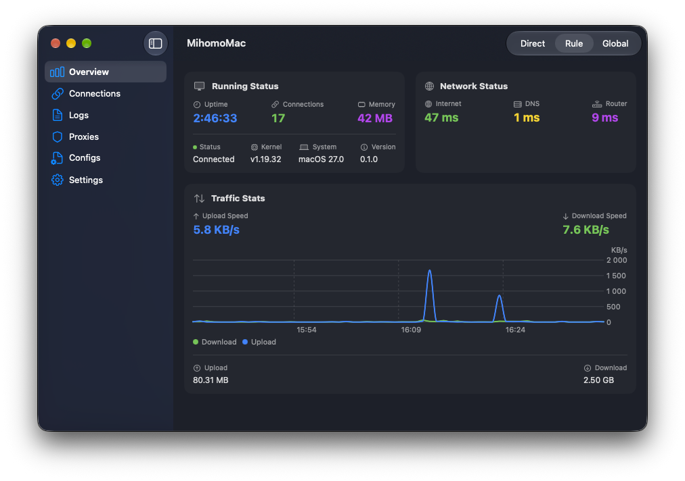

# MihomoMac

A native macOS app for managing the [mihomo](https://github.com/MetaCubeX/mihomo) proxy kernel from the menu bar and a SwiftUI dashboard.

MihomoMac manages a separately installed mihomo executable. It does not bundle a kernel, proxy subscription, or server credentials.



## Features

- Start and stop mihomo from the dashboard or menu bar.
- View traffic, active connection counts, memory usage, and network latency.
- Inspect connections, close individual connections, and read kernel logs.
- Browse proxy groups, including nodes supplied by proxy providers, select an outbound, and test latency.
- Create, edit, duplicate, rename, and switch local YAML configuration profiles.
- Switch between Rule, Global, and Direct modes.
- Enable macOS System Proxy separately from the mihomo process.
- Launch at login and automatically start mihomo, without enabling System Proxy.
- Copy local proxy environment-variable exports from the menu bar.

Closing the dashboard keeps the app in the menu bar. Use **Open Dashboard** or **Command–Shift–D** to reopen it, and **Quit** to exit.

## Requirements

- macOS 14 or later.
- A mihomo executable for your Mac, downloaded separately from the [upstream releases](https://github.com/MetaCubeX/mihomo/releases).
- A valid mihomo YAML configuration with an HTTP controller.

Building from source additionally requires full Xcode 16 or later and [XcodeGen](https://github.com/yonaskolb/XcodeGen). The project uses Swift 5.9 language mode and resolves dependencies through Swift Package Manager.

## Build from source

Install Xcode and its command-line tools, then install XcodeGen if needed:

```sh
brew install xcodegen
```

From the repository root:

```sh
xcodegen generate
open MihomoMac.xcodeproj
```

Select the **MihomoMac** scheme and **My Mac**, then build and run. On a fresh setup, Xcode may ask you to review and enable build plug-ins required by the editor dependency. Review their sources before approving them.

For a command-line build:

```sh
xcodebuild build \
  -project MihomoMac.xcodeproj \
  -scheme MihomoMac \
  -configuration Debug \
  -destination 'platform=macOS' \
  -derivedDataPath build/DerivedData
```

The generated Xcode project and build outputs are local files and are excluded from Git. An Apple Developer account is not required to edit the source or generate the project. Distribution signing is configured separately; see [RELEASING.md](RELEASING.md).

## First run

1. Download and unpack the appropriate mihomo executable. Ensure it has executable permission.
2. In **Settings → Mihomo Binary**, select that executable.
3. Open **Configs**, choose a profile, and edit its YAML. The folder button opens the profile directory in Finder if you want to copy an existing configuration there.
4. Configure the controller to listen on loopback. Use a unique controller secret for your own setup.
5. Save the profile, make it active, and click **Start** in Settings or the menu bar.
6. Enable **System Proxy** only if you want macOS applications to use the local proxy automatically.

For reference, these settings enable local HTTP/SOCKS and controller listeners:

```yaml
mixed-port: 7890
allow-lan: false
external-controller: 127.0.0.1:9090
secret: replace-with-your-own-controller-secret
mode: rule
log-level: info
rules:
  - MATCH,DIRECT
```

This example routes traffic directly. Add your own proxy definitions, providers, groups, and rules using the [mihomo documentation](https://wiki.metacubex.one/en/). The example secret is a placeholder.

New profiles contain a minimal starter configuration. Check their controller address before starting: the starter uses `0.0.0.0:9090`; replace it with `127.0.0.1:9090` for local-only controller access.

## Startup and System Proxy

**Settings → Startup → Launch at Login** registers MihomoMac as a macOS login item. At login, the app starts mihomo using the configured binary and active profile. It does not enable System Proxy. Ordinary manual launches do not automatically start the kernel.

System Proxy is a separate switch that changes macOS HTTP, HTTPS, and SOCKS proxy settings. Stopping mihomo or quitting MihomoMac disables the proxy through the app's cleanup path. Previous custom proxy settings are not saved for restoration.

## Local data and privacy

Profiles and profile metadata are stored in:

```text
~/Library/Application Support/MihomoMac/configs/mihomo/
```

Application preferences use the `com.fino-app.MihomoMac` defaults domain. Changing from an older bundle identifier can require selecting the mihomo executable again.

Configuration files, process output, logs, and connection details can contain private addresses and credentials. Keep them out of commits and public bug reports. See [PRIVACY.md](PRIVACY.md) for stored data and outbound requests.

## Development

See [CONTRIBUTING.md](CONTRIBUTING.md) for the development workflow and tests, [CHANGELOG.md](CHANGELOG.md) for changes, and [SECURITY.md](SECURITY.md) for vulnerability reporting.

## License

MihomoMac source is available under the [MIT License](LICENSE). Dependencies and the separately installed mihomo kernel retain their own licenses; see [THIRD_PARTY_NOTICES.md](THIRD_PARTY_NOTICES.md).
